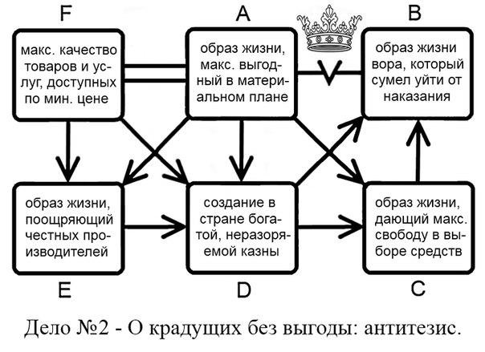

# Диалог

<table>
<colgroup>
<col style="width: 14%" />
<col style="width: 85%" />
</colgroup>
<thead>
<tr class="header">
<th><em>Ведущий</em>:</th>
<th>Как по-вашему, выгодно ли воровать? С материальной точки зрения.</th>
</tr>
<tr class="odd">
<th><em>Ответчик</em>:</th>
<th>Нет, воровать даже с материальной точки зрения невыгодно. Может в отдельные моменты это кажется выгодным, но в целом воровской образ жизни несовместим с максимально выгодным образом жизни.</th>
</tr>
<tr class="header">
<th><em>Ведущий</em>:</th>
<th>Максимально выгодный образ жизни с материальной точки зрения - это возможность удовлетворения всех материальных потребностей?</th>
</tr>
<tr class="odd">
<th><em>Ответчик</em>:</th>
<th>Да.</th>
</tr>
<tr class="header">
<th><em>Ведущий</em>:</th>
<th>Материальные потребности всегда удовлетворяются при помощи какого-либо материального блага, не так ли?</th>
</tr>
<tr class="odd">
<th><em>Ответчик</em>:</th>
<th>Думаю, да. Можно, конечно, вспомнить про всяких там йогов, но я считаю, что это из другой оперы.</th>
</tr>
<tr class="header">
<th><em>Ведущий</em>:</th>
<th>Влияет ли качество благ на степень удовлетворения потребностей? Если благо некачественное, оно может обеспечить максимально выгодный образ жизни?</th>
</tr>
<tr class="odd">
<th><em>Ответчик</em>:</th>
<th>Не может. Качество благ, безусловно, имеет значение.</th>
</tr>
<tr class="header">
<th><em>Ведущий</em>:</th>
<th>Значит максимально выгодный образ жизни всегда предполагает наличие качественных материальных благ. Блага эти всегда производят или доставляют люди, верно?</th>
</tr>
<tr class="odd">
<th><em>Ответчик</em>:</th>
<th>Да, фирмы, люди.</th>
</tr>
<tr class="header">
<th><em>Ведущий</em>:</th>
<th>Значит максимально выгодный образ жизни всегда предполагает наличие качественных материальных благ, зависящих от людей. И тогда максимально выгодный образ жизни всегда предполагает достаточное количество надежных людей. Ведь качество блага зависит от них, не так ли?</th>
</tr>
<tr class="odd">
<th><em>Ответчик</em>:</th>
<th>Да</th>
</tr>
<tr class="header">
<th><em>Ведущий</em>:</th>
<th>Для того, чтобы люди надежно производили качественные блага, нужна определенная система, включающая оплату труда, закупку материалов, обеспечение условий труда. Чтобы эта система работала, её нужно достаточно финансировать, так?</th>
</tr>
<tr class="odd">
<th><em>Ответчик</em>:</th>
<th>Да</th>
</tr>
<tr class="header">
<th><em>Ведущий</em>:</th>
<th>Раз всем людям нужны блага и удовлетворение потребностей, они и скидываются на работу этой системы. Создают общий бюджет, так?</th>
</tr>
<tr class="odd">
<th><em>Ответчик</em>:</th>
<th>Да</th>
</tr>
<tr class="header">
<th><em>Ведущий</em>:</th>
<th>Чтобы деньги не разворовали, нужно охранять этот общий бюджет?</th>
</tr>
<tr class="odd">
<th><em>Ответчик</em>:</th>
<th>Не нужен, т.к. деньги не разворуют. Все люди будут честные и никто ничего из общака не украдёт. Они же понимают, в конце-концов, что им же хуже будет.</th>
</tr>
<tr class="header">
<th><em>Ведущий</em>:</th>
<th>И все эти честные и понимающие люди будут со свободной волей? Не будут подвержены гипнозу, зомбированию или другим средствам интеллектуальной унификации?</th>
</tr>
<tr class="odd">
<th><em>Ответчик</em>:</th>
<th>Нет конечно! Ерунда какая.</th>
</tr>
<tr class="header">
<th><em>Ведущий</em>:</th>
<th>Если у них будет возможность свободно рассуждать, то у них останется и возможность рассудить так, что кто-то всё-таки украдёт общие деньги?</th>
</tr>
<tr class="odd">
<th><em>Ответчик</em>:</th>
<th>Нет, этого решительно не может быть! Это же нецелесообразно.</th>
</tr>
<tr class="header">
<th><em>Ведущий</em>:</th>
<th>Допустим, что нецелесообразно. А вы сами хоть иногда ошибаетесь?</th>
</tr>
<tr class="odd">
<th><em>Ответчик</em>:</th>
<th>Да, бывает.</th>
</tr>
<tr class="header">
<th><em>Ведущий</em>:</th>
<th>Значит, иногда поступаете нецелесообразно?</th>
</tr>
<tr class="odd">
<th><em>Ответчик</em>:</th>
<th>В общем, да.</th>
</tr>
<tr class="header">
<th><em>Ведущий</em>:</th>
<th>Так если вы можете поступить в каком-то вопросе нецелесообразно, то и другие могут ошибиться и поступить нецелесообразно в вопросе воровства?</th>
</tr>
<tr class="odd">
<th><em>Ответчик</em>:</th>
<th>Да, ошибиться они могут.</th>
</tr>
<tr class="header">
<th><em>Ведущий</em>:</th>
<th>Если они могут ошибиться, то есть возможность и того, что деньги разворуют?</th>
</tr>
<tr class="odd">
<th><em>Ответчик</em>:</th>
<th>Да</th>
</tr>
<tr class="header">
<th><em>Ведущий</em>:</th>
<th>Что выгодней: когда есть возможность потерять материально выгодный образ жизни из-за разворованного бюджета? Или когда такая возможность сведена к минимуму? - Видимо, второе.</th>
</tr>
<tr class="odd">
<th><em>Ответчик</em>:</th>
<th>Раз нужно минимизировать возможность воровства, деньги надо охранять. Кто может охранять? Охранник?</th>
</tr>
<tr class="header">
<th><em>Ведущий</em>:</th>
<th>Охранник может. Хотя он-то тоже не запрограммированная машина, а человек. Тоже может разворовать.</th>
</tr>
<tr class="odd">
<th><em>Ответчик</em>:</th>
<th>Значит оставлять деньги без охраны не выгодно. И приставлять охранника тоже невыгодно, т.к. любой, кто не обладает этими деньгами, может иметь соблазн и возможность украсть их, так?</th>
</tr>
<tr class="header">
<th><em>Ведущий</em>:</th>
<th>Да</th>
</tr>
<tr class="odd">
<th><em>Ответчик</em>:</th>
<th>Видимо, остаётся только такой вариант, где бюджетные деньги уже принадлежат тому, кто их охраняет?</th>
</tr>
<tr class="header">
<th><em>Ведущий</em>:</th>
<th>Вроде логично. Только с чего это вдруг ему люди свои деньги-то отдадут? Может у него самого эти деньги своруют. Так что не могу согласиться.</th>
</tr>
<tr class="odd">
<th><em>Ответчик</em>:</th>
<th>Надо отдавать тому, у кого не своруют. А у кого не своруют: у того, кто успешнее в доставании денег, их охране и обращении с ними или у того, кто в этом менее преуспевает?</th>
</tr>
<tr class="header">
<th><em>Ведущий</em>:</th>
<th>У того, кто преуспел больше всех других.</th>
</tr>
<tr class="odd">
<th><em>Ответчик</em>:</th>
<th>А кто преуспевает больше других: тот, кто ограничен моральным и юридическим законом в доставании денег или тот, кто не ограничен им?</th>
</tr>
<tr class="header">
<th><em>Ведущий</em>:</th>
<th>Не знаю. Допустим, что тот, кто ограничен.</th>
</tr>
<tr class="odd">
<th><em>Ответчик</em>:</th>
<th>Лучше с делом справляется всегда тот, кто имеет на то больше возможностей?</th>
</tr>
<tr class="header">
<th><em>Ведущий</em>:</th>
<th>Да</th>
</tr>
<tr class="odd">
<th><em>Ответчик</em>:</th>
<th>А кто имеет больше возможностей: тот, у кого эти возможности ограничены или тот, у кого нет ограничений?</th>
</tr>
<tr class="header">
<th><em>Ведущий</em>:</th>
<th>Второй</th>
</tr>
<tr class="odd">
<th><em>Ответчик</em>:</th>
<th>Значит преуспевает в доставании денег всегда тот, у кого нет ограничений перед законом?</th>
</tr>
<tr class="header">
<th><em>Ведущий</em>:</th>
<th>Да</th>
</tr>
<tr class="odd">
<th><em>Ответчик</em>:</th>
<th>А кого закон не ограничивает в воровстве и доставании денег: того, кто соблюдает его и чтит или того, кто не соблюдает и ворует?</th>
</tr>
<tr class="header">
<th><em>Ведущий</em>:</th>
<th>Второй, очевидно, не ограничен законом.</th>
</tr>
<tr class="odd">
<th><em>Ответчик</em>:</th>
<th>Значит отдавать бюджет на сохранение выгодней не честному, а вору?</th>
</tr>
<tr class="header">
<th><em>Ведущий</em>:</th>
<th>Выходит так. Только у этого вора с лёгкостью может украсть другой такой же, ничем не ограниченный вор.</th>
</tr>
<tr class="odd">
<th><em>Ответчик</em>:</th>
<th>В обществе появляются те, кто ворует и стремится этим нажиться. Кто-то из них в этом деле более искусен, а кто-то - менее, так?</th>
</tr>
<tr class="header">
<th><em>Ведущий</em>:</th>
<th>Равно как и в любом другом деле, да.</th>
</tr>
<tr class="odd">
<th><em>Ответчик</em>:</th>
<th>По-настоящему искусный вор всегда ворует так, чтобы у него не отняли наворованное назад, верно? Иначе дело для него обернулось бы плохо: поймали бы на воровстве, отобрали наворованное и применили бы правовые санкции.</th>
</tr>
<tr class="header">
<th><em>Ведущий</em>:</th>
<th>Конечно.</th>
</tr>
<tr class="odd">
<th><em>Ответчик</em>:</th>
<th>И, опасаясь, что бюджет разворуют, мы более всего опасаемся как раз тех, кто в воровстве более искусен. Потому как он может украсть и у честных людей, и у менее искусного вора, верно?</th>
</tr>
<tr class="header">
<th><em>Ведущий</em>:</th>
<th>Да</th>
</tr>
<tr class="odd">
<th><em>Ответчик</em>:</th>
<th>А у него украсть, напротив, будет сложнее всего. Потому что он наиболее искусе⁷н и лучше всех остальных сумеет сохранить сворованные деньги.</th>
</tr>
<tr class="header">
<th><em>Ведущий</em>:</th>
<th>Согласен.</th>
</tr>
<tr class="odd">
<th><em>Ответчик</em>:</th>
<th>Получается:  
1) Для того, чтобы обеспечить материально выгодный образ жизни, нужно производить блага.  
2) Для производства благ нужна система, финансируемая бюджетом.  
3) Чтобы финансирование было успешным, нужно, чтобы возможность его воровства отсутствовала или была минимальной.  
4) У самого себя украсть нельзя. Поэтому для того, чтобы максимально обезопасить деньги, следует сделать так, чтобы бюджет принадлежал охраняющему его субъекту, который наилучшим образом выполнял бы эту функцию.  
5) Наилучшим образом выполняет функцию охраны бюджета самый искусный вор. Значит, для того, чтобы максимально обезопасить деньги, следует сделать так, чтобы бюджет принадлежал охраняющему его субъекту, который наилучшим образом выполнял бы эту функцию.  
 
Получается, что материально выгодный образ жизни всегда предполагает наличие такого искусного вора. А значит, без воровства невозможен материально выгодный образ жизни.</th>
</tr>
<tr class="header">
<th><em>Ответчик</em>:</th>
<th>Да</th>
</tr>
</thead>
<tbody>
</tbody>
</table>
