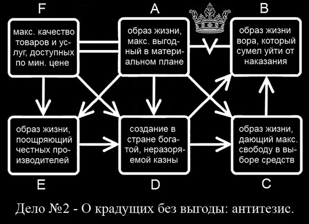

# Монолог

**Ключевые определения**

- Материально выгодный образ жизни - это возможность удовлетворить материальные потребности с минимальными затратами. 

- Воровской образ жизни - это любое приобретение материальных благ в обход социального договора.

**Содержание**

- Для удовлетворения материальных потребностей необходимы качественные материальные блага.

- Для обеспечения качественными благами необходима система, финансирующая производство и распределение благ.

- Чтобы система финансирования действовала, населению необходимо организовать сбор бюджета из общих денег.

- Если оставить этот бюджет без охраны, его могут разворовать нечестные люди. Даже если люди в обществе честные, у них остаётся возможность выбора воровства.

- А если существует риск разворовывания бюджета - выгодней его ликвидировать или снизить, чем сохранять.

- Снизить риск воровства можно, организовав надзор, охрану бюджета.

- Но охраняющий субъект - сознательный человек, у которого так же, как у других людей остаётся возможность украсть деньги из бюджета. Значит риск разворовывания бюджета, пусть и меньший, но все равно остается. И его так же выгодней минимизировать.

- Любой, кто охраняет чужие деньги, может их украсть. А нужен тот, кто не может украсть деньги. Значит: нужен тот, кто будет охранять бюджет как свои деньги: ведь у себя украсть нельзя.

- Однако остаётся возможность, что у такого субъекта украдут деньги другие люди. Чтобы такого по возможности не происходило, необходим субъект, у которого было бы украсть тяжелее всего.

- А тяжелее всего украсть у того, кто сам умеет воровать и сохранять наворованное лучше всех остальных.

- Получается, что максимально выгодный образ жизни всегда предполагает наличие воровского образа жизни среди властимущих.
