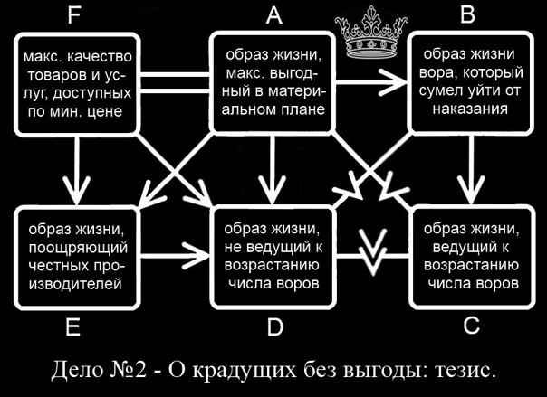

# Дело о крадущих без выгоды- тезис

**Дело о крадущих без выгоды: тезис**

**УТОЧНЕНИЕ ТЕЗИСА**

0.1 [Уточнение тезиса](%D0%A3%D1%82%D0%BE%D1%87%D0%BD%D0%B5%D0%BD%D0%B8%D0%B5%20%D1%82%D0%B5%D0%B7%D0%B8%D1%81%D0%B0--1p21iNYb.md)

0.2 [Договор об условии поражения ](%D0%94%D0%BE%D0%B3%D0%BE%D0%B2%D0%BE%D1%80%20%D0%BE%20%D0%BF%D0%BE%D1%80%D0%B0%D0%B6%D0%B5%D0%BD%D0%B8%D0%B8--1bRIG4Hm.md)

0.3 [Метка перед кальцинацией](%D0%9C%D0%B5%D1%82%D0%BA%D0%B0%20%D0%BF%D0%B5%D1%80%D0%B5%D0%B4%20%D0%BA%D0%B0%D0%BB%D1%8C%D1%86%D0%B8%D0%BD%D0%B0%D1%86%D0%B8%D0%B5%D0%B9--1OOIIaRr.md)

**КАЛЬЦИНАЦИЯ**

***Максимально выгодный образ жизни***

1 [Максимальная выгода](%D0%9C%D0%B0%D1%82%D0%B5%D1%80%D0%B8%D0%B0%D0%BB%D1%8C%D0%BD%D0%BE%20%D0%B2%D1%8B%D0%B3%D0%BE%D0%B4%D0%BD%D1%8B%D0%B9%20%D0%BE%D0%B1%D1%80%D0%B0%D0%B7%20%D0%B6%D0%B8%D0%B7%D0%BD%D0%B8--1A4VnZfJ.md)

1.1 [Определение выгоды ](%D0%92%D1%8B%D0%B3%D0%BE%D0%B4%D0%B0--1VZbBwH6.md)

1.1.1 [Определение значимого](%D0%97%D0%BD%D0%B0%D1%87%D0%B8%D0%BC%D0%BE%D0%B5--1DdxnWGL.md)

1.1.1.1 [Получение более значимого](../%D0%94%D0%BE%D0%BF%D0%BE%D0%BB%D0%BD%D0%B8%D1%82%D0%B5%D0%BB%D1%8C%D0%BD%D1%8B%D0%B5%20%D1%88%D0%B0%D0%B3%D0%B8/%D0%9F%D0%BE%D0%BB%D1%83%D1%87%D0%B5%D0%BD%D0%B8%D0%B5%20%D0%B1%D0%BE%D0%BB%D0%B5%D0%B5%20%D0%B7%D0%BD%D0%B0%D1%87%D0%B8%D0%BC%D0%BE%D0%B3%D0%BE--1yzrjOSX.md)

1.1.1.1.1 [Возможность удовлетворения потребностей](../%D0%94%D0%BE%D0%BF%D0%BE%D0%BB%D0%BD%D0%B8%D1%82%D0%B5%D0%BB%D1%8C%D0%BD%D1%8B%D0%B5%20%D1%88%D0%B0%D0%B3%D0%B8/%D0%92%D0%BE%D0%B7%D0%BC%D0%BE%D0%B6%D0%BD%D0%BE%D1%81%D1%82%D1%8C%20%D1%83%D0%B4%D0%BE%D0%B2%D0%BB%D0%B5%D1%82%D0%B2%D0%BE%D1%80%D0%B5%D0%BD%D0%B8%D1%8F%20%D0%BF%D0%BE%D1%82%D1%80%D0%B5%D0%B1%D0%BD%D0%BE%D1%81%D1%82%D0%B5%D0%B9--1HxlMxfl.md)

1.1.1.1.1.1 [Минимальные затраты на удовлетворение потребностей](../%D0%94%D0%BE%D0%BF%D0%BE%D0%BB%D0%BD%D0%B8%D1%82%D0%B5%D0%BB%D1%8C%D0%BD%D1%8B%D0%B5%20%D1%88%D0%B0%D0%B3%D0%B8/%D0%9C%D0%B8%D0%BD%D0%B8%D0%BC%D0%B0%D0%BB%D1%8C%D0%BD%D1%8B%D0%B5%20%D0%B7%D0%B0%D1%82%D1%80%D0%B0%D1%82%D1%8B%20%D0%BD%D0%B0%20%D1%83%D0%B4%D0%BE%D0%B2%D0%BB%D0%B5%D1%82%D0%B2%D0%BE%D1%80%D0%B5%D0%BD%D0%B8%D0%B5%20%D0%BF%D0%BE%D1%82%D1%80%D0%B5%D0%B1%D0%BD%D0%BE%D1%81%D1%82%D0%B5%D0%B9--1lkkugPv.md)

***Воровской образ жизни***

2.[Воровство - это всегда приобретение благ ](../%D0%94%D0%BE%D0%BF%D0%BE%D0%BB%D0%BD%D0%B8%D1%82%D0%B5%D0%BB%D1%8C%D0%BD%D1%8B%D0%B5%20%D1%88%D0%B0%D0%B3%D0%B8/%D0%92%D0%BE%D1%80%D0%BE%D0%B2%D1%81%D1%82%D0%B2%D0%BE%20-%20%D1%8D%D1%82%D0%BE%20%D0%B2%D1%81%D0%B5%D0%B3%D0%B4%D0%B0%20%D0%BF%D1%80%D0%B8%D0%BE%D0%B1%D1%80%D0%B5%D1%82%D0%B5%D0%BD%D0%B8%D0%B5%20%D0%B1%D0%BB%D0%B0%D0%B3--1PdewK8X.md)

2.1 [Воровство всегда нарушает договор ](../%D0%94%D0%BE%D0%BF%D0%BE%D0%BB%D0%BD%D0%B8%D1%82%D0%B5%D0%BB%D1%8C%D0%BD%D1%8B%D0%B5%20%D1%88%D0%B0%D0%B3%D0%B8/%D0%92%D0%BE%D1%80%D0%BE%D0%B2%D1%81%D1%82%D0%B2%D0%BE%20%D0%B2%D1%81%D0%B5%D0%B3%D0%B4%D0%B0%20%D0%BD%D0%B0%D1%80%D1%83%D1%88%D0%B0%D0%B5%D1%82%20%D0%B4%D0%BE%D0%B3%D0%BE%D0%B2%D0%BE%D1%80--1bRPo06v.md)

2.1.1 [Воровство - приобретение благ в обход социального договора](../%D0%94%D0%BE%D0%BF%D0%BE%D0%BB%D0%BD%D0%B8%D1%82%D0%B5%D0%BB%D1%8C%D0%BD%D1%8B%D0%B5%20%D1%88%D0%B0%D0%B3%D0%B8/%D0%92%D0%BE%D1%80%D0%BE%D0%B2%D1%81%D1%82%D0%B2%D0%BE%20-%20%D0%BF%D1%80%D0%B8%D0%BE%D0%B1%D1%80%D0%B5%D1%82%D0%B5%D0%BD%D0%B8%D0%B5%20%D0%B1%D0%BB%D0%B0%D0%B3%20%D0%B2%20%D0%BE%D0%B1%D1%85%D0%BE%D0%B4%20%D1%81%D0%BE%D1%86%D0%B8%D0%B0%D0%BB%D1%8C%D0%BD%D0%BE%D0%B3%D0%BE%20%D0%B4%D0%BE%D0%B3%D0%BE%D0%B2%D0%BE%D1%80%D0%B0--1DKnP4et.md)

3. [Завершение кальцинации](../%D0%94%D0%BE%D0%BF%D0%BE%D0%BB%D0%BD%D0%B8%D1%82%D0%B5%D0%BB%D1%8C%D0%BD%D1%8B%D0%B5%20%D1%88%D0%B0%D0%B3%D0%B8/%D0%97%D0%B0%D0%B2%D0%B5%D1%80%D1%88%D0%B5%D0%BD%D0%B8%D0%B5%20%D0%BA%D0%B0%D0%BB%D1%8C%D1%86%D0%B8%D0%BD%D0%B0%D1%86%D0%B8%D0%B8--13eZmZAJ.md)

**НАЧАЛО СПОРА**

***Необходимость материальных благ для материально выгодного образа жизни***

*4* [Необходимость материальных благ ](../%D0%94%D0%BE%D0%BF%D0%BE%D0%BB%D0%BD%D0%B8%D1%82%D0%B5%D0%BB%D1%8C%D0%BD%D1%8B%D0%B5%20%D1%88%D0%B0%D0%B3%D0%B8/%D0%9D%D0%B5%D0%BE%D0%B1%D1%85%D0%BE%D0%B4%D0%B8%D0%BC%D0%BE%D1%81%D1%82%D1%8C%20%D0%BC%D0%B0%D1%82%D0%B5%D1%80%D0%B8%D0%B0%D0%BB%D1%8C%D0%BD%D1%8B%D1%85%20%D0%B1%D0%BB%D0%B0%D0%B3--1mlMQUq6.md)

4.1 [Необходимость качества материальных благ](../%D0%94%D0%BE%D0%BF%D0%BE%D0%BB%D0%BD%D0%B8%D1%82%D0%B5%D0%BB%D1%8C%D0%BD%D1%8B%D0%B5%20%D1%88%D0%B0%D0%B3%D0%B8/%D0%9D%D0%B5%D0%BE%D0%B1%D1%85%D0%BE%D0%B4%D0%B8%D0%BC%D0%BE%D1%81%D1%82%D1%8C%20%D0%BA%D0%B0%D1%87%D0%B5%D1%81%D1%82%D0%B2%D0%B0%20%D0%BC%D0%B0%D1%82%D0%B5%D1%80%D0%B8%D0%B0%D0%BB%D1%8C%D0%BD%D1%8B%D1%85%20%D0%B1%D0%BB%D0%B0%D0%B3--1IR53uNZ.md)

***Необходимость неувеличения воров для материально выгодного образа жизни***

5 [Необходимость честных и надёжных людей ](../%D0%94%D0%BE%D0%BF%D0%BE%D0%BB%D0%BD%D0%B8%D1%82%D0%B5%D0%BB%D1%8C%D0%BD%D1%8B%D0%B5%20%D1%88%D0%B0%D0%B3%D0%B8/%D0%9D%D0%B5%D0%BE%D0%B1%D1%85%D0%BE%D0%B4%D0%B8%D0%BC%D0%BE%D1%81%D1%82%D1%8C%20%D1%87%D0%B5%D1%81%D1%82%D0%BD%D1%8B%D1%85%20%D0%B8%20%D0%BD%D0%B0%D0%B4%D1%91%D0%B6%D0%BD%D1%8B%D1%85%20%D0%BB%D1%8E%D0%B4%D0%B5%D0%B9--1LE4Dqp7.md)

5.1 [Материальные блага без честных и надёжных людей ](../%D0%94%D0%BE%D0%BF%D0%BE%D0%BB%D0%BD%D0%B8%D1%82%D0%B5%D0%BB%D1%8C%D0%BD%D1%8B%D0%B5%20%D1%88%D0%B0%D0%B3%D0%B8/%D0%9C%D0%B0%D1%82%D0%B5%D1%80%D0%B8%D0%B0%D0%BB%D1%8C%D0%BD%D1%8B%D0%B5%20%D0%B1%D0%BB%D0%B0%D0%B3%D0%B0%20%D0%B1%D0%B5%D0%B7%20%D1%87%D0%B5%D1%81%D1%82%D0%BD%D1%8B%D1%85%20%D0%B8%20%D0%BD%D0%B0%D0%B4%D1%91%D0%B6%D0%BD%D1%8B%D1%85%20%D0%BB%D1%8E%D0%B4%D0%B5%D0%B9--1CgCN3Ib.md)

5.1.1 [Материально выгодный образ жизни и честные люди ](../%D0%94%D0%BE%D0%BF%D0%BE%D0%BB%D0%BD%D0%B8%D1%82%D0%B5%D0%BB%D1%8C%D0%BD%D1%8B%D0%B5%20%D1%88%D0%B0%D0%B3%D0%B8/%D0%9C%D0%B0%D1%82%D0%B5%D1%80%D0%B8%D0%B0%D0%BB%D1%8C%D0%BD%D0%BE%20%D0%B2%D1%8B%D0%B3%D0%BE%D0%B4%D0%BD%D1%8B%D0%B9%20%D0%BE%D0%B1%D1%80%D0%B0%D0%B7%20%D0%B6%D0%B8%D0%B7%D0%BD%D0%B8%20%D0%B8%20%D1%87%D0%B5%D1%81%D1%82%D0%BD%D1%8B%D0%B5%20%D0%BB%D1%8E%D0%B4%D0%B8--1vAmcpcJ.md)

5.1.1.1 [Для материально выгодного образа жизни необходимо неувеличение воров](../%D0%94%D0%BE%D0%BF%D0%BE%D0%BB%D0%BD%D0%B8%D1%82%D0%B5%D0%BB%D1%8C%D0%BD%D1%8B%D0%B5%20%D1%88%D0%B0%D0%B3%D0%B8/%D0%94%D0%BB%D1%8F%20%D0%BC%D0%B0%D1%82%D0%B5%D1%80%D0%B8%D0%B0%D0%BB%D1%8C%D0%BD%D0%BE%20%D0%B2%D1%8B%D0%B3%D0%BE%D0%B4%D0%BD%D0%BE%D0%B3%D0%BE%20%D0%BE%D0%B1%D1%80%D0%B0%D0%B7%D0%B0%20%D0%B6%D0%B8%D0%B7%D0%BD%D0%B8%20%D0%BD%D0%B5%D0%BE%D0%B1%D1%85%D0%BE%D0%B4%D0%B8%D0%BC%D0%BE%20%D0%BD%D0%B5%D1%83%D0%B2%D0%B5%D0%BB%D0%B8%D1%87%D0%B5%D0%BD%D0%B8%D0%B5%20%D0%B2%D0%BE%D1%80%D0%BE%D0%B2--1Dn4mH7h.md)

***Необходимость увеличения подельников для воровства***

6 [В совершенно честном обществе вора поймают](../%D0%94%D0%BE%D0%BF%D0%BE%D0%BB%D0%BD%D0%B8%D1%82%D0%B5%D0%BB%D1%8C%D0%BD%D1%8B%D0%B5%20%D1%88%D0%B0%D0%B3%D0%B8/%D0%92%20%D1%81%D0%BE%D0%B2%D0%B5%D1%80%D1%88%D0%B5%D0%BD%D0%BD%D0%BE%20%D1%87%D0%B5%D1%81%D1%82%D0%BD%D0%BE%D0%BC%20%D0%BE%D0%B1%D1%89%D0%B5%D1%81%D1%82%D0%B2%D0%B5%20%D0%B2%D0%BE%D1%80%D0%B0%20%D0%BF%D0%BE%D0%B9%D0%BC%D0%B0%D1%8E%D1%82--1b3ZFnBL.md)

6.1 [Воровать в одиночку или с подельниками](../%D0%94%D0%BE%D0%BF%D0%BE%D0%BB%D0%BD%D0%B8%D1%82%D0%B5%D0%BB%D1%8C%D0%BD%D1%8B%D0%B5%20%D1%88%D0%B0%D0%B3%D0%B8/%D0%92%D0%BE%D1%80%D0%BE%D0%B2%D0%B0%D1%82%D1%8C%20%D0%B2%20%D0%BE%D0%B4%D0%B8%D0%BD%D0%BE%D1%87%D0%BA%D1%83%20%D0%B8%D0%BB%D0%B8%20%D1%81%20%D0%BF%D0%BE%D0%B4%D0%B5%D0%BB%D1%8C%D0%BD%D0%B8%D0%BA%D0%B0%D0%BC%D0%B8--1drIsARt.md)

6.1.1 [Подельникам нужно прикрытие](../%D0%94%D0%BE%D0%BF%D0%BE%D0%BB%D0%BD%D0%B8%D1%82%D0%B5%D0%BB%D1%8C%D0%BD%D1%8B%D0%B5%20%D1%88%D0%B0%D0%B3%D0%B8/%D0%9F%D0%BE%D0%B4%D0%B5%D0%BB%D1%8C%D0%BD%D0%B8%D0%BA%D0%B0%D0%BC%20%D0%BD%D1%83%D0%B6%D0%BD%D0%BE%20%D0%BF%D1%80%D0%B8%D0%BA%D1%80%D1%8B%D1%82%D0%B8%D0%B5--1MZmzB48.md)

6.1.1.1 [Усиление общественных пороков](../%D0%94%D0%BE%D0%BF%D0%BE%D0%BB%D0%BD%D0%B8%D1%82%D0%B5%D0%BB%D1%8C%D0%BD%D1%8B%D0%B5%20%D1%88%D0%B0%D0%B3%D0%B8/%D0%A3%D1%81%D0%B8%D0%BB%D0%B5%D0%BD%D0%B8%D0%B5%20%D0%BE%D0%B1%D1%89%D0%B5%D1%81%D1%82%D0%B2%D0%B5%D0%BD%D0%BD%D1%8B%D1%85%20%D0%BF%D0%BE%D1%80%D0%BE%D0%BA%D0%BE%D0%B2--1igDjyR1.md)

6.1.1.1.1 [Воровской образ жизни несовместим с материально выгодным ](../%D0%94%D0%BE%D0%BF%D0%BE%D0%BB%D0%BD%D0%B8%D1%82%D0%B5%D0%BB%D1%8C%D0%BD%D1%8B%D0%B5%20%D1%88%D0%B0%D0%B3%D0%B8/%D0%92%D0%BE%D1%80%D0%BE%D0%B2%D1%81%D0%BA%D0%BE%D0%B9%20%D0%BE%D0%B1%D1%80%D0%B0%D0%B7%20%D0%B6%D0%B8%D0%B7%D0%BD%D0%B8%20%D0%BD%D0%B5%D1%81%D0%BE%D0%B2%D0%BC%D0%B5%D1%81%D1%82%D0%B8%D0%BC%20%D1%81%20%D0%BC%D0%B0%D1%82%D0%B5%D1%80%D0%B8%D0%B0%D0%BB%D1%8C%D0%BD%D0%BE%20%D0%B2%D1%8B%D0%B3%D0%BE%D0%B4%D0%BD%D1%8B%D0%BC--17SwmwRx.md)
